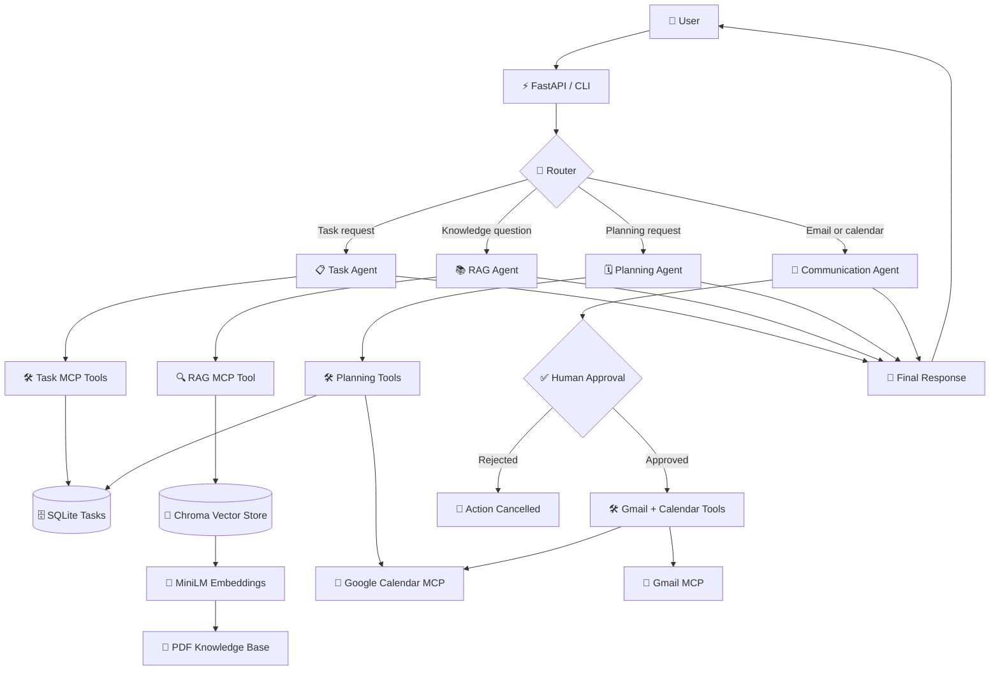
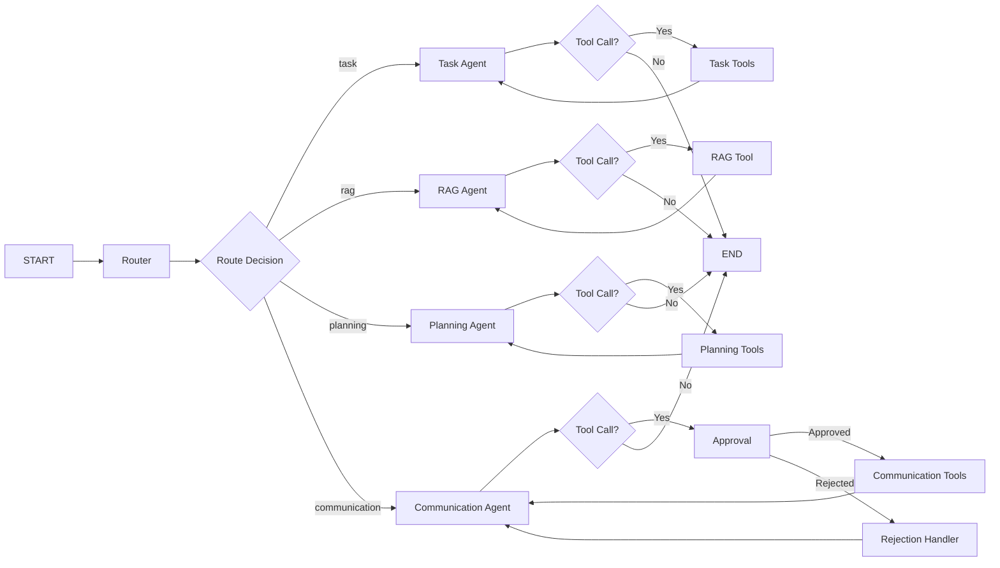
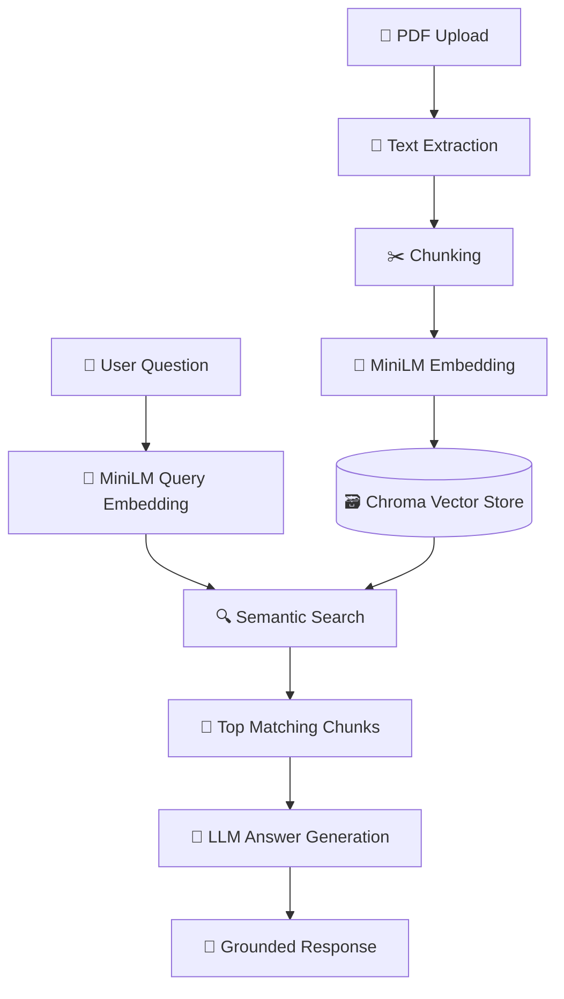
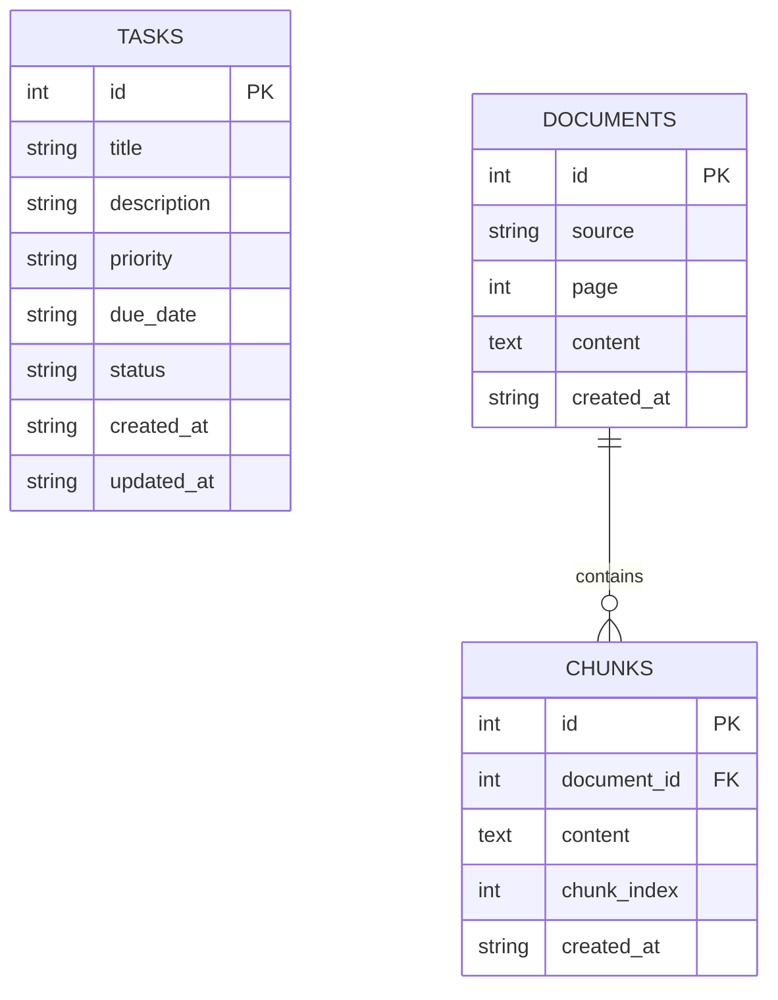
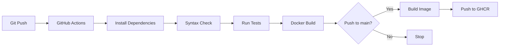

<div align="center">

# 🧠 WorkMate AI

### Agentic AI Productivity Assistant

An intelligent, modular assistant that helps users manage tasks, search project knowledge, plan work, and communicate through Gmail and Google Calendar.

Built with **FastAPI**, **LangGraph**, **MCP**, **Chroma**, **MiniLM embeddings**, **SQLite**, and **Docker**.


</div>

---

## 📌 Overview

**WorkMate AI** is a production-oriented agentic AI application that understands natural-language requests and routes them to specialized agents.

Instead of using one large chatbot, WorkMate AI uses a **multi-agent workflow**:

| Agent | Responsibility |
|---|---|
| **Router** | Understands the user request and selects the correct specialist agent |
| **Task Agent** | Creates, updates, completes, deletes, and lists tasks |
| **RAG Agent** | Answers questions from uploaded PDF knowledge using Chroma and MiniLM embeddings |
| **Planning Agent** | Combines saved tasks with calendar availability |
| **Communication Agent** | Searches Gmail, reads email, creates drafts, sends email, and manages calendar events |

The system uses **human-in-the-loop approval** before executing sensitive actions such as sending email or deleting calendar events.

---

## ✨ Key Features

- 🤖 **Multi-agent architecture** using LangGraph
- 🧭 **Intelligent request routing** to task, RAG, planning, or communication agents
- 📄 **RAG knowledge base** for PDF-based question answering
- 🔍 **Local semantic search** using `OpenAI`
- 🗃️ **Chroma vector database** for persistent document retrieval
- 🗂️ **SQLite task management**
- 📧 **Gmail integration** through MCP
- 📅 **Google Calendar integration** through MCP
- ✅ **Human approval workflow** for sensitive actions
- 🐳 **Dockerized deployment**
- 🔄 **GitHub Actions CI/CD**
- 🧪 **FastAPI test support**
- 🔐 **Authentication-ready API design**
- 📈 **Extensible tool registry**
- 🧩 **Model Context Protocol (MCP)** for modular tool integration

---

## 🏗️ System Architecture



---

## 🔁 Production Agent Workflow



---

## 🧠 RAG Pipeline



### RAG Flow

1. PDF documents are parsed and split into chunks.
2. Each chunk is converted into a vector using `all-MiniLM-L6-v2`.
3. Vectors and metadata are stored in Chroma.
4. When a user asks a question, the query is embedded.
5. Chroma retrieves the most semantically similar chunks.
6. The RAG agent uses the retrieved context to generate an answer.
7. Source and page metadata are returned with the answer.

---

## 🗄️ Database Schema



### Task Table

| Field | Type | Description |
|---|---|---|
| `id` | INTEGER | Primary key |
| `title` | TEXT | Task title |
| `description` | TEXT | Optional task details |
| `priority` | TEXT | `low`, `medium`, or `high` |
| `due_date` | TEXT | Optional due date in `YYYY-MM-DD` |
| `status` | TEXT | `pending` or `completed` |
| `created_at` | TEXT | Task creation timestamp |
| `updated_at` | TEXT | Last update timestamp |

---

## 📁 Project Structure

```text
workmate-ai-langgraph-rag-agents/
│
├── backend/
│   ├── core/
│   │   ├── config.py
│   │   └── logging.py
│   │
│   ├── data/
│   │   └── workmate_db.py
│   │
│   └── src/
│       ├── api/
│       │   ├── main.py
│       │   └── schemas.py
│       │
│       ├── assistant/
│       │   └── llm.py
│       │
│       ├── graph/
│       │   ├── state.py
│       │   ├── router.py
│       │   └── workflow.py
│       │
│       ├── agents/
│       │   ├── task_agent.py
│       │   ├── chat_agent.py
│       │   ├── planning_agent.py
│       │   └── communication_agent.py
│       │
│       ├── mcp/
│       │   ├── mcp_client.py
│       │   ├── workmate_mcp.py
│       │   └── google_mcp.py
│       │
│       ├── rag/
│       │   ├── embeddings.py
│       │   ├── vectorstore.py
│       │   ├── retriever.py
│       │   ├── ingest.py
│       │   └── reranker.py
│       │
│       └── tools/
│           └── tool_registry.py
│
├── tests/
│   └── test_health.py
│
├── .dockerignore
├── .env.example
├── .gitignore
├── docker-compose.yml
├── Dockerfile
├── requirements.txt
└── README.md
```

---

## 🚀 Getting Started

### 1. Clone the repository

```bash
git clone [https://github.com/your-username/workmate-ai-langgraph-rag-agents.git](https://github.com/your-username/workmate-ai-langgraph-rag-agents.git)
cd workmate-ai-langgraph-rag-agents
```

### 2. Create a virtual environment

```bash
uv venv
```

Activate it:

```powershell
.venv\Scripts\activate
```

### 3. Install dependencies

```bash
uv pip install -r requirements.txt
```

### 4. Configure environment variables

Create a `.env` file:

```env
OPENROUTER_API_KEY=your_openrouter_api_key
OPENROUTER_MODEL_NAME=your_openrouter_model

HUGGINGFACE_MODEL_NAME= OpenAI

GOOGLE_CLOUD_PROJECT_ID=your_google_project_id
GOOGLE_CLIENT_ID=your_google_client_id
GOOGLE_CLIENT_SECRET=your_google_client_secret

GOOGLE_CREDENTIALS_FILE=credentials.json
GOOGLE_TOKEN_FILE=token.json
```

### 5. Ingest PDF documents

```bash
uv run python -m backend.src.rag.ingest
```

### 6. Run the CLI

```bash
uv run python -m backend.src.main
```

### 7. Run the API

```bash
uv run uvicorn backend.src.api.main:app --reload
```

Open:

```text
http://127.0.0.1:8000/docs
```

---

## 🐳 Docker Deployment

### Build and start

```bash
docker compose up -d --build
```

### Check logs

```bash
docker compose logs -f workmate-api
```

### Test the API

```bash
curl http://localhost:8000/health
```

### Stop the application

```bash
docker compose down
```

---

## 🔌 API Endpoints

### Health Check

```http
GET /health
```

Response:

```json
{
  "status": "healthy",
  "application": "WorkMate AI"
}
```

### Send Chat Message

```http
POST /chat
```

Request:

```json
{
  "message": "What does the productivity document say about the RAG workflow?",
  "thread_id": "user-thread-1"
}
```

Response:

```json
{
  "status": "completed",
  "response": "The RAG workflow retrieves relevant document chunks and uses them to generate a grounded answer."
}
```

### Approve or Reject Action

```http
POST /approval
```

Request:

```json
{
  "thread_id": "user-thread-1",
  "decision": "approved"
}
```

---

## 🧩 MCP Tool Groups

| Group | Tools |
|---|---|
| **Task** | `create_task`, `list_tasks`, `update_task`, `complete_task`, `delete_task` |
| **RAG** | `rag_tool` |
| **Planning** | `list_tasks`, `list_calendar_events`, `create_calendar_event` |
| **Communication** | `search_emails`, `read_email`, `create_email_draft`, `send_email`, `list_calendar_events`, `create_calendar_event` |

---

## 🔐 Security Model

WorkMate AI is designed with a security-first API structure:

- User identity is read from authenticated middleware, not from the request body.
- Thread ownership must be validated before accessing conversation state.
- Sensitive communication actions require explicit human approval.
- Secrets are excluded from Docker images through `.dockerignore`.
- Environment variables are used for API keys and OAuth credentials.
- Production deployments should use a persistent checkpointer and database-backed thread ownership.

---

## 🧪 Testing

Run tests:

```bash
pytest -q
```

Check syntax:

```bash
python -m compileall -q backend
```

---

## 🔄 CI/CD Pipeline



The pipeline validates Python syntax, runs tests, builds the Docker image, and publishes versioned images to GitHub Container Registry.

---

## 🚀 Advanced Roadmap

### Phase 1: Core Intelligence

- [x] Multi-agent LangGraph workflow
- [x] Router-based request classification
- [x] RAG knowledge search
- [x] Task management
- [x] Gmail integration
- [x] Google Calendar integration
- [x] Human approval workflow

### Phase 2: Production Hardening

- [x] PostgreSQL-backed conversation history
- [x] Redis-backed task queue
- [x] Persistent LangGraph checkpointer
- [ ] JWT authentication
- [ ] Role-based access control
- [ ] Rate limiting
- [ ] Structured JSON logging
- [ ] Prometheus metrics
- [ ] OpenTelemetry tracing

### Phase 3: Advanced RAG

- [ ] Cross-encoder reranking
- [ ] Hybrid keyword + semantic search
- [ ] Query rewriting
- [ ] Multi-document retrieval
- [ ] Citation highlighting
- [ ] Document versioning
- [ ] Incremental PDF ingestion

### Phase 4: Agent Upgrades

- [ ] Long-term user memory
- [ ] Personalized planning
- [ ] Meeting preparation agent
- [ ] Daily briefing agent
- [ ] Email triage agent
- [ ] Autonomous task suggestions
- [ ] Multi-user workspace support

---

## 📊 Example Use Cases

### Task Management

```text
Create a high-priority task to prepare the project demo for Friday.
```

### Knowledge Search

```text
What does the productivity document say about the RAG workflow?
```

### Planning

```text
Check my calendar and help me plan my pending tasks for this week.
```

### Communication

```text
Search my Gmail for the project update email and draft a reply.
```

---

## 🛠️ Technology Stack

| Layer | Technology |
|---|---|
| Backend | Python, FastAPI |
| Agent Framework | LangGraph |
| Tool Protocol | Model Context Protocol |
| LLM | OpenRouter |
| Embeddings | `all-MiniLM-L6-v2` |
| Vector Database | Chroma |
| Database | SQLite |
| PDF Processing | PyPDF |
| Authentication | OAuth 2.0-ready |
| Containerization | Docker |
| CI/CD | GitHub Actions |
| Registry | GitHub Container Registry |

---

## 🤝 Contributing

1. Fork the repository.
2. Create a feature branch.
3. Make your changes.
4. Add or update tests.
5. Run `pytest`.
6. Submit a pull request.

---

## 📄 License

This project is licensed under the MIT License.

---

<div align="center">

**WorkMate AI**  
*An agentic AI assistant for tasks, knowledge, planning, and communication.*

</div>
